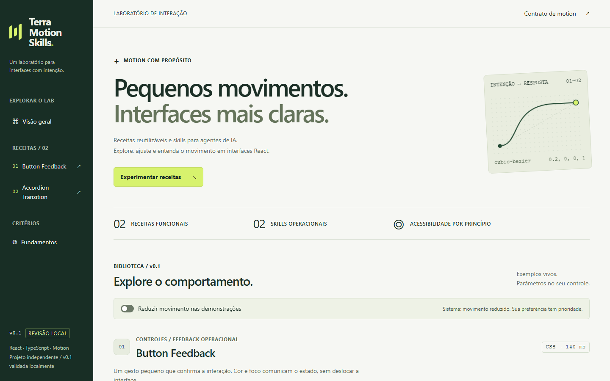

# Terra Motion Skills

[English](README.en.md) · **v0.1 — marco técnico local validado** · Repositório público no GitHub

Receitas de motion para React e skills operacionais para agentes de IA. Duas receitas reutilizáveis, tokens neutros e um showcase com demonstrações reais, sem dependência da vitrine para consumir as receitas. Projeto independente, sem afiliação com a Motion. O nome do projeto e identificador do repositório são Terra Motion Skills e terra-motion-skills.



**Demo online:** ainda não publicada. Execute localmente. As capturas A1 mostram o refinamento aprovado; mensagens editoriais de nome/licença podem diferir da cópia preparada depois.

## Instalação e execução

Ambiente verificado: Windows, Node **24.20.0** e pnpm **11.24.0**. Faixa aceita pelas ferramentas: Node `^22.22.2 || ^24.15.0 || >=26.0.0`; os demais ambientes não compõem uma matriz testada. React/React DOM 19.3.1 e Motion 14.3.0 estão fixados no lockfile. Se pnpm não estiver disponível, consulte a [instalação oficial](https://pnpm.io/installation) e use a versão fixada.

Repositório público: [joaquimftt-web/terra-motion-skills](https://github.com/joaquimftt-web/terra-motion-skills), branch `main`. Clone o projeto e entre na raiz que contém pnpm-workspace.yaml. Não há credenciais ou .env necessários.

```sh
git clone https://github.com/joaquimftt-web/terra-motion-skills.git
cd terra-motion-skills
pnpm install --frozen-lockfile
pnpm dev
```

Abra o endereço mostrado pelo Vite, normalmente http://127.0.0.1:5173. O comando compila os pacotes antes de iniciar a vitrine. Após editar receitas/tokens, rode `pnpm build:packages` para atualizar exports compilados. Para inspecionar um build local:

```sh
pnpm build
pnpm --filter @motion-skills-lab/showcase preview
```

Preview é ferramenta local, não servidor de produção. Hospedagem e publicação npm não estão configuradas.

## Identidade e compatibilidade

Nome oficial: **Terra Motion Skills**; repositório público: [joaquimftt-web/terra-motion-skills](https://github.com/joaquimftt-web/terra-motion-skills). O escopo local `@motion-skills-lab/*`, o nome do workspace e os nomes das skills permanecem por compatibilidade. Os exemplos abaixo usam os identificadores reais; não há pacotes publicados no registry. O nome anterior aparece em registros históricos e capturas A1 preservadas. [Inventário e decisão](docs/IDENTITY.md).

## Receitas reais

- **Button Feedback:** botão nativo, props/ref do consumidor, cor/borda em hover/press, foco visível e disabled; sem scale, 140 ms.
- **Accordion Transition:** disclosure controlado, IDs/ARIA, painel fechado inert e aria-hidden, altura reversível com Motion; 180 ms por padrão.
- **Showcase:** duração ajustável, replay/reinício, contador de ativações, disabled e cópia com sucesso/fallback reais.

A preferência reduzida do sistema tem prioridade e atualiza durante a sessão. Accordion reduz conservadoramente quando matchMedia não está disponível. Conteúdo e lógica de negócio pertencem ao consumidor.

### Button Feedback

Os pacotes são locais e privados, sem publicação em registry. Use os exports compilados em outro workspace local, com React/React DOM 19 e Motion para Accordion. Não é um comando de instalação npm. `check:consumer` valida manifests/dist e peers sem fontes ou vitrine.

```tsx
import { ButtonFeedback } from '@motion-skills-lab/motion-recipes/button-feedback';
import '@motion-skills-lab/motion-recipes/button-feedback.css';

export function ConfirmButton({ onConfirm }: { onConfirm: () => void }) {
  return (
    <ButtonFeedback type="button" onClick={onConfirm}>
      Confirmar
    </ButtonFeedback>
  );
}
```

### Accordion Transition

```tsx
import { useState } from 'react';
import { AccordionTransition } from '@motion-skills-lab/motion-recipes/accordion-transition';
import '@motion-skills-lab/motion-recipes/accordion-transition.css';

export function Details() {
  const [open, setOpen] = useState(false);
  return (
    <AccordionTransition open={open} onOpenChange={setOpen} trigger="Detalhes">
      <p>Conteúdo controlado pela sua aplicação.</p>
    </AccordionTransition>
  );
}
```

Há quatro subpaths de receita/CSS, sem barrel raiz. Tokens CSS são opcionais pelos fallbacks; APIs e limites estão no [contrato](docs/MOTION_CONTRACT.md).

## Skills e arquitetura

Leia [motion-foundations](skills/motion-foundations/SKILL.md) e [microinteraction-design](skills/microinteraction-design/SKILL.md) a partir deste clone. São instruções operacionais com parâmetros, exemplos, restrições, acessibilidade e validação. Não são runtime nem se instalam automaticamente no agente; preservar os diretórios mantém os links relativos válidos. A validação estrutural não certifica eficácia de agentes.

- `apps/showcase` consome exports públicos dos pacotes.
- `packages/motion-tokens` define timing/easing neutros.
- `packages/motion-recipes` contém Button e Accordion independentes.
- `skills` contém instruções; `docs` registra decisões, contratos, fontes e evidências.

[Arquitetura](docs/ARCHITECTURE.md) · [Decisões](docs/DECISIONS.md) · [Roadmap](docs/ROADMAP.md)

## Validação e limites

```sh
pnpm typecheck
pnpm build
pnpm lint
pnpm format:check
pnpm test
pnpm validate:skills
pnpm check:boundaries
pnpm check:consumer
pnpm exec playwright install chromium
pnpm test:e2e
```

A base refinada passou em **22 testes Vitest, 17 Playwright e oito auditorias axe** nas quatro larguras. Há evidência histórica adicional de zoom nativo de 200% em Chromium com uma auditoria axe sem violações retornadas. A revalidação específica desta cópia está em [VALIDATION.md](docs/VALIDATION.md). E2E precisa da porta 4173 livre e de Chromium instalado.

Somente Windows/Chromium foi executado: não há alegação de compatibilidade validada com outros navegadores, leitores de tela, dispositivos físicos ou certificação de acessibilidade. Sem medições de FPS/hardware. A2 (fronteiras) e A3 (preferência durante replay agendado) permanecem no backlog. GSAP, Lenis, WebGL, Drawer e novas receitas não integram a v0.1.

## Capturas e demonstração

[Desktop completo](docs/evidence/a1/after/showcase-1440-full.png) · [1024 px](docs/evidence/a1/after/showcase-1024-full.png) · [390 px](docs/evidence/a1/after/showcase-390-full.png) · [320 px](docs/evidence/a1/after/showcase-320-full.png) · [Antes/depois A1](docs/REFINEMENT_A1.md)


A futura demo estática dependerá de autorização e dos avisos legais aplicáveis. Não há URL fictícia, deploy, CI ou badge de publicação.

## Licenciamento e colaboração

**Código original sob a licença [MIT](LICENSE).** Copyright (c) 2026 Joaquim Freitas. Os manifests permanecem privados para evitar publicação acidental de pacotes. Dependências mantêm seus próprios termos: [notices](THIRD_PARTY_NOTICES.md), [fontes/licenças](docs/REFERENCES_AND_LICENSES.md) e [inventário](docs/DEPENDENCY_LICENSES.json).

[Contribuições](docs/CONTRIBUTING.md) · [Changelog](docs/CHANGELOG.md) · [Estado da publicação](docs/PUBLICATION_STATUS.md)
